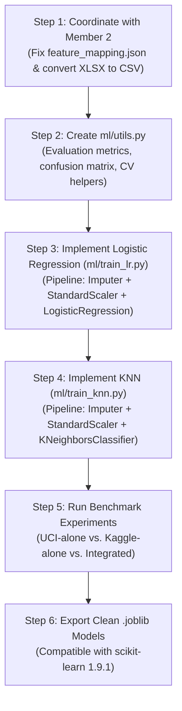

# Member 3 Project Audit & Verification Report
**Project Name:** Student Dropout Early Warning System  
**Auditor:** Senior Machine Learning Engineer & Project Auditor  
**Role Audited:** Member 3 (Logistic Regression, KNN, ML Training & Evaluation Utilities)  
**Date of Audit:** November 13, 2026  
**Audit Policy:** Read-Only Verification (No source code or datasets modified)  

---

## Executive Summary

This audit assesses the technical progress, dataset integrity, and machine learning readiness of the **Student Dropout Early Warning System** project. Member 3 is responsible for developing, training, and evaluating **Logistic Regression** and **K-Nearest Neighbours (KNN)** classifiers, implementing leakage-free evaluation utilities, handling class imbalance, and saving deployable ML pipelines.

### Primary Audit Verdict
- **Dataset Ground Truth:** The project possesses two genuine raw datasets: UCI Dataset 697 (Portuguese higher-ed, 4,424 rows, 3-class target) and Kaggle Synthetic Dropout (10,000 rows, binary target, stored as an Excel `.xlsx` workbook).
- **Member 2 ETL Architecture:** The data validation and FastAPI framework in `pipeline.py` and `main.py` are well-structured, but the feature mapping configuration (`config/feature_mapping.json`) is **unconfigured for Kaggle** (`REPLACE_WITH_...` placeholders).
- **Existing ML Outputs:** The existing `.joblib` models and CSV evaluation files in `student_dropout_project_outputs/` are **untraceable, orphaned artifacts** created outside the repository. Furthermore, all 9 `.joblib` model files **cannot be loaded** in the current environment due to a breaking scikit-learn version mismatch (`v1.6.1` vs `v1.9.1`).
- **Member 3 Readiness:** Member 3 has **not yet written training code**, which is actually advantageous: Member 3 should **rebuild clean, reproducible Logistic Regression and KNN pipelines from scratch** rather than attempting to rescue incompatible, unverified legacy model files.

---

## A. Project Overview & Structure

The root directory contains two top-level directories:

```text
Project/
│
├── Student-Dropout-Early-Warning-System/         <-- Active Project Codebase & Web Application
│   ├── audit/                                   <-- Audit Documentation Directory
│   │   └── MEMBER_3_PROJECT_AUDIT.md            <-- This Audit Report
│   ├── config/
│   │   └── feature_mapping.json                 <-- Schema harmonization register (Incomplete)
│   ├── data/
│   │   ├── experiments/                         <-- Target folder for train/test leakage-free splits
│   │   ├── processed/                           <-- Target folder for concatenated exports
│   │   └── raw/
│   │       ├── student_dropout_dataset_cleaned.csv  <-- UCI Dataset 697 (Real, Portugal)
│   │       └── student_dropout_dataset_v3 (2).csv.xlsx <-- Kaggle Synthetic (Excel format)
│   ├── docs/
│   │   ├── feature_mapping.md                   <-- Feature definitions and caveats
│   │   └── integration_methodology.md           <-- Theoretical integration protocol
│   ├── ml/                                      <-- EMPTY (Reserved for Member 3 ML code)
│   ├── notebooks/
│   │   └── 01_dataset_understanding.ipynb       <-- Exploratory Data Analysis (EDA) notebook
│   ├── static/                                  <-- Dashboard Front-end (HTML5 / CSS / Vanilla JS)
│   │   ├── app.js
│   │   ├── index.html
│   │   └── styles.css
│   ├── tests/
│   │   └── test_pipeline.py                     <-- Unit tests for upload & schema validation
│   ├── .gitignore                               <-- Version control exclusions
│   ├── download_datasets.py                     <-- Automated dataset fetcher (UCI & Kaggle)
│   ├── main.py                                  <-- FastAPI server & REST API
│   ├── pipeline.py                              <-- ETL, data quality checks, feature derivation
│   ├── preprocessing.py                         <-- Holdout splitting & leakage-free transformers
│   ├── README.md                                <-- System documentation
│   ├── requirements.txt                         <-- Core project dependency declarations
│   ├── .venv/                                   <-- Python 3.14.4 virtual environment
│   └── .git/                                    <-- Git source repository (1 commit: dc7a492)
│
└── student_dropout_project_outputs/             <-- Orphaned ML Outputs & Obsolete Models
    ├── cleaned_kaggle.csv                       <-- Pre-cleaned Kaggle slice
    ├── cleaned_uci.csv                          <-- Pre-cleaned UCI slice
    ├── combined_student_dropout_dataset.csv     <-- Row-concatenated dataset (13,630 rows)
    ├── cross_validation_results.csv             <-- Untraceable CV benchmark metrics
    ├── model_comparison.csv                     <-- Untraceable model benchmark metrics
    ├── student_risk_predictions.csv             <-- Risk scores and risk tiers
    ├── decision_tree.joblib                     <-- Incompatible model checkpoint
    ├── gaussian_naive_bayes.joblib              <-- Incompatible model checkpoint
    ├── knn.joblib                               <-- Incompatible model checkpoint
    ├── lightgbm.joblib                          <-- Incompatible model checkpoint
    ├── logistic_regression.joblib              <-- Incompatible model checkpoint
    ├── random_forest.joblib                     <-- Incompatible model checkpoint
    ├── svm.joblib                               <-- Incompatible model checkpoint
    ├── tuned_random_forest.joblib               <-- Incompatible model checkpoint
    └── xgboost.joblib                           <-- Incompatible model checkpoint
```

---

## B. Dataset Verification

Both datasets located in `Student-Dropout-Early-Warning-System/data/raw/` were verified using automated read-only inspection.

### 1. UCI Portuguese Higher Education Dataset (`student_dropout_dataset_cleaned.csv`)
* **File Format & Size:** Standard CSV (`.csv`), 528,802 bytes (~516.4 KB).
* **Dimensions:** 4,424 rows and 37 columns.
* **Target Column:** `Target` (string categorical).
* **Target Class Distribution:** Multiclass with 3 distinct outcomes:
  * `Graduate`: 2,209 instances (49.93%)
  * `Dropout`: 1,421 instances (32.12%)
  * `Enrolled`: 794 instances (17.95%)
* **Missing Values:** Exactly 0 missing values across all 37 columns (complete data).
* **Duplicate Rows:** Exactly 0 duplicate rows.
* **Data Types:** 30 integer columns (`int64`), 6 floating point columns (`float64`), 1 categorical string column (`Target`).
* **Feature Ranges & Outliers:**
  * `Age at enrollment`: Ranges from 17 to 70 years (mean: 23.27, std: 7.59). The maximum of 70 represents mature non-traditional students.
  * `Admission grade` & `Previous qualification (grade)`: 95.0 to 190.0 (Portuguese 0–200 scale).
  * `Curricular units 1st sem (grade)`: 0.0 to 18.88 (Portuguese 0–20 scale). Values of 0.0 correspond to non-evaluated subjects.
* **Class Imbalance:** Moderate class imbalance. Graduate is the majority class (~50%), Dropout is ~32%, and Enrolled is ~18%.
* **Potential ID Columns:** None. Student identities are completely anonymous.
* **Potential Target / Look-Ahead Leakage:** Columns relating to the 2nd semester (`Curricular units 2nd sem (approved)`, `Curricular units 2nd sem (grade)`, `Curricular units 2nd sem (evaluations)`) occur late in the student's academic timeline. If the early warning system's business objective is to detect dropout risk at enrollment or during the 1st semester, including 2nd semester outcomes constitutes look-ahead leakage.

### 2. Kaggle Synthetic Dropout Dataset (`student_dropout_dataset_v3 (2).csv.xlsx`)
* **File Format & Size:** Microsoft Excel OpenXML Workbook (`.xlsx`), 1,008,379 bytes (~984.7 KB). Note: It possesses a compound extension `.csv.xlsx`, but physical inspection confirms it is a binary Excel workbook requiring `openpyxl` / `pd.read_excel()`.
* **Dimensions:** 10,000 rows and 19 columns.
* **Target Column:** `Dropout` (integer binary).
* **Target Class Distribution:**
  * `0` (Retained / Non-dropout): 7,646 instances (76.46%)
  * `1` (Dropout): 2,354 instances (23.54%)
* **Missing Values:** Present in exactly 4 features (total 2,011 missing cells):
  * `Family_Income`: 500 missing (5.00%)
  * `Study_Hours_per_Day`: 500 missing (5.00%)
  * `Stress_Index`: 500 missing (5.00%)
  * `Parental_Education`: 511 missing (5.11%)
* **Duplicate Rows:** Exactly 0 duplicate rows.
* **Data Types:** 7 categorical string columns (`Gender`, `Internet_Access`, `Part_Time_Job`, `Scholarship`, `Semester`, `Department`, `Parental_Education`), 9 float numerical columns (`Age`, `Family_Income`, `Study_Hours_per_Day`, `Attendance_Rate`, `Travel_Time_Minutes`, `Stress_Index`, `GPA`, `Semester_GPA`, `CGPA`), 3 integer columns (`Student_ID`, `Assignment_Delay_Days`, `Dropout`).
* **Feature Ranges & Outliers:**
  * `Family_Income`: Minimum $25,000, Maximum $316,601 (mean: $38,377, heavy positive skew).
  * `Attendance_Rate`: 38.2% to 100.0% (mean: 81.74%).
  * `GPA`, `Semester_GPA`, `CGPA`: 0.0 to 4.0 (US 4.0 GPA scale).
* **Class Imbalance:** Significant binary imbalance ratio of ~3.25:1 (76.5% negative class vs 23.5% positive class).
* **Potential ID Columns:** `Student_ID` (values from 1 to 10,000 in uniform sequence). **CRITICAL:** This is an artificial database primary key and must be dropped before training to prevent spurious memorization.
* **Potential Target Leakage:** `CGPA` and `Semester_GPA` may reflect grades recorded after a student has already ceased attendance.

### 3. Cross-Dataset Compatibility Analysis
A fundamental question of the project is whether UCI and Kaggle can be combined into a single dataset.
* **Incompatible Grading Metrics:** UCI uses a 0–20 Portuguese grading scale; Kaggle uses a 0.0–4.0 US GPA scale. Direct pooling without rank-based normalization (percentile ranking) distorts the feature space.
* **Non-overlapping Feature Definitions:** Kaggle captures behavioral and personal variables (`Study_Hours_per_Day`, `Attendance_Rate`, `Stress_Index`, `Internet_Access`), whereas UCI captures administrative and semester-credit milestones (`Curricular units credited/approved/evaluated`, national economic indicators `Unemployment rate`, `Inflation rate`, `GDP`).
* **Target Semantics Conflict:** UCI contains an active 3rd category (`Enrolled`, 794 students) who are actively studying. Forcing UCI into binary format requires either discarding `Enrolled` (losing 18% of the data) or assuming `Enrolled = Non-Dropout` (introducing label noise).
* **Scientific Conclusion:** The datasets are **not natively homogeneous**. They can only be compared via parallel experiments (UCI-alone vs. Kaggle-alone) or via standardized percentile rank harmonization.

---

## C. Member 2 Progress Verification

Member 2 is responsible for dataset management, schema harmonization, upload verification, and preprocessing.

| Verification Item | Status | Detailed Findings & Code Locations |
|---|:---:|---|
| **1. Dataset Upload & Validation** | **VERIFIED COMPLETE** | Implemented in [pipeline.py](file:///c:/Users/DELL/Documents/Quick%20Share/Sem%205/ML/Project/Student-Dropout-Early-Warning-System/pipeline.py#L24-L56) (`validate_upload`, `load_dataset`) and [main.py](file:///c:/Users/DELL/Documents/Quick%20Share/Sem%205/ML/Project/Student-Dropout-Early-Warning-System/main.py#L55-L75). Strictly enforces `.csv` extension, MIME types, file size limits (<20MB), non-blank headers, duplicate column rejection, and UTF-8/Latin-1 encoding fallback. |
| **2. Feature Mapping Correctness** | **INCOMPLETE / BLOCKED** | In [config/feature_mapping.json](file:///c:/Users/DELL/Documents/Quick%20Share/Sem%205/ML/Project/Student-Dropout-Early-Warning-System/config/feature_mapping.json#L16-L30), the `kaggle_synthetic` block contains placeholder strings (`REPLACE_WITH_AGE_COLUMN`, `REPLACE_WITH_OUTCOME_COLUMN`). It cannot execute for Kaggle data. |
| **3. Schema Alignment** | **PARTIALLY COMPLETE** | The mechanism exists in [pipeline.py](file:///c:/Users/DELL/Documents/Quick%20Share/Sem%205/ML/Project/Student-Dropout-Early-Warning-System/pipeline.py#L164-L190) (`_derive_feature`), supporting operations like `percentile_mean`, `difference`, and `financial_stress`. However, alignment cannot run end-to-end until mapping aliases are populated. |
| **4. Target-Label Handling** | **PARTIALLY COMPLETE** | [pipeline.py](file:///c:/Users/DELL/Documents/Quick%20Share/Sem%205/ML/Project/Student-Dropout-Early-Warning-System/pipeline.py#L124-L136) supports `target_mode="preserve"` (maintains 3 classes for UCI) and `binary_dropout`. However, `binary_dropout` silently maps `Enrolled: 0`, conflating actively studying students with graduates. |
| **5. Source Identification** | **VERIFIED COMPLETE** | [pipeline.py](file:///c:/Users/DELL/Documents/Quick%20Share/Sem%205/ML/Project/Student-Dropout-Early-Warning-System/pipeline.py#L123) correctly attaches `mapped["source"] = source_key` to each row for data provenance. |
| **6. Missing Value Handling** | **VERIFIED COMPLETE** | [pipeline.py](file:///c:/Users/DELL/Documents/Quick%20Share/Sem%205/ML/Project/Student-Dropout-Early-Warning-System/pipeline.py#L152-L161) adds missingness indicators (`add_missingness_flags`), and [preprocessing.py](file:///c:/Users/DELL/Documents/Quick%20Share/Sem%205/ML/Project/Student-Dropout-Early-Warning-System/preprocessing.py#L45-L48) fits `SimpleImputer` strictly on training data. |
| **7. Duplicate Detection** | **VERIFIED COMPLETE** | [pipeline.py](file:///c:/Users/DELL/Documents/Quick%20Share/Sem%205/ML/Project/Student-Dropout-Early-Warning-System/pipeline.py#L61) tracks and reports duplicate rows without silent deletion. |
| **8. Categorical Encoding** | **VERIFIED COMPLETE** | [preprocessing.py](file:///c:/Users/DELL/Documents/Quick%20Share/Sem%205/ML/Project/Student-Dropout-Early-Warning-System/preprocessing.py#L46-L47) uses `OneHotEncoder(handle_unknown="ignore", sparse_output=False)` inside a `ColumnTransformer`. |
| **9. Numerical Scaling** | **VERIFIED COMPLETE** | [preprocessing.py](file:///c:/Users/DELL/Documents/Quick%20Share/Sem%205/ML/Project/Student-Dropout-Early-Warning-System/preprocessing.py#L45) fits `StandardScaler()` on training features only. |
| **10. Train/Test Splitting** | **VERIFIED COMPLETE** | [preprocessing.py](file:///c:/Users/DELL/Documents/Quick%20Share/Sem%205/ML/Project/Student-Dropout-Early-Warning-System/preprocessing.py#L34) implements `train_test_split(..., test_size=0.2, random_state=42, stratify=stratify)`. |
| **11. Leakage Prevention** | **PARTIALLY COMPLETE (Subtle Risk)** | [preprocessing.py](file:///c:/Users/DELL/Documents/Quick%20Share/Sem%205/ML/Project/Student-Dropout-Early-Warning-System/preprocessing.py#L50-L51) strictly fits scalers and imputers on training rows only. **However**, in [pipeline.py](file:///c:/Users/DELL/Documents/Quick%20Share/Sem%205/ML/Project/Student-Dropout-Early-Warning-System/pipeline.py#L177-L182), `raw[c].rank(pct=True)` computes percentile ranks across the entire raw file before train/test splitting, introducing a subtle global rank leakage. |
| **12. Processed Export** | **VERIFIED COMPLETE** | [main.py](file:///c:/Users/DELL/Documents/Quick%20Share/Sem%205/ML/Project/Student-Dropout-Early-Warning-System/main.py#L101-L104) and [preprocessing.py](file:///c:/Users/DELL/Documents/Quick%20Share/Sem%205/ML/Project/Student-Dropout-Early-Warning-System/preprocessing.py#L52-L59) export train/test splits (`X_train.csv`, `X_test.csv`, `y_train.csv`, `y_test.csv`). |

---

## D. Existing ML Artifacts Verification (`student_dropout_project_outputs/`)

The directory `student_dropout_project_outputs/` contains pre-existing outputs from a previous or external training run.

### 1. Verification of CSV Outputs
* **`cleaned_uci.csv`** (4,424 rows, 37 cols): A lowercase column rename of the raw UCI dataset. No missing values.
* **`cleaned_kaggle.csv`** (10,000 rows, 19 cols): A lowercase column rename of the raw Kaggle dataset. Retains 500 missing values in 4 columns.
* **`combined_student_dropout_dataset.csv`** (13,630 rows, 10 cols):
  * Target distribution: `0`: 9,855; `1`: 3,775.
  * Breakdown: Kaggle contributed 10,000 rows; UCI contributed 3,630 rows.
  * **Critical Observation:** In UCI, all 794 `Enrolled` students were completely eliminated ($4,424 - 794 = 3,630$), and the remaining UCI labels were forced into binary (`Graduate` = 0, `Dropout` = 1).
  * Contains an unexplained `cluster` column (values 0, 1, 2) generated from an unsupervised clustering algorithm.
  * Contains 506 exact duplicate rows.
* **`student_risk_predictions.csv`** (2,726 rows, 10 cols): Exactly represents an 80/20 test split ($2,726 / 13,630 = 0.2000$). Contains model probabilities and risk tiers (`Medium Risk`: 1,133; `Low Risk`: 1,070; `High Risk`: 523).
* **`model_comparison.csv` & `cross_validation_results.csv`**: Record performance metrics across 8 algorithms.

### 2. Verification of Model Checkpoints (`.joblib`)
An attempt was made to safely inspect the 9 `.joblib` model artifacts using the virtual environment's Python interpreter:
```text
C:\...\sklearn\base.py:525: InconsistentVersionWarning: 
Trying to unpickle estimator SimpleImputer from version 1.6.1 when using version 1.9.1.
Error loading logistic_regression.joblib: module 'sklearn.compose._column_transformer' has no attribute '_RemainderColsList'
Error loading knn.joblib: module 'sklearn.compose._column_transformer' has no attribute '_RemainderColsList'
... (all 9 models failed with identical error)
```

#### Technical Finding:
1. **Broken Deserialization:** The models were serialized under `scikit-learn 1.6.1`. The local project environment runs `scikit-learn 1.9.1`. Because private internal classes (`_RemainderColsList`) were refactored in scikit-learn 1.9, **none of these models can be loaded, evaluated, or served**.
2. **Missing Source Code:** There is **no training script** in the repository that produced these models.
3. **Audit Verdict on Artifacts:** These `.joblib` files are **OBSOLETE and UNVERIFIED**. Member 3 must **not** attempt to reuse them. Member 3 must build and train their own clean models using scikit-learn 1.9.1.

---

## E. Member 3 Progress & Readiness Assessment

Member 3's role encompasses 11 core responsibilities. Here is the exact status of each:

| # | Responsibility | Status | Audit Findings & Beginner-Friendly Explanation |
|---|---|:---:|---|
| 1 | **Logistic Regression** | **NOT STARTED** | No implementation code exists. The legacy `.joblib` cannot be loaded. Member 3 needs to implement an LR classifier pipeline. |
| 2 | **K-Nearest Neighbours (KNN)** | **NOT STARTED** | No implementation code exists. KNN strictly requires feature scaling (standardization), which Member 3 must incorporate into the pipeline. |
| 3 | **Model training and evaluation utilities** | **NOT STARTED** | The `ml/` folder is completely empty. Member 3 needs to create reusable Python functions (e.g., `train_model`, `evaluate_model`). |
| 4 | **Stratified train/test splitting** | **PARTIALLY COMPLETE** | The theoretical logic is coded in Member 2's `preprocessing.py`, but Member 3 has not yet built an ML script that imports and executes it. |
| 5 | **Cross-validation** | **NOT STARTED** | Stratified $K$-fold cross-validation has not been implemented in code. Cross-validation must run inside training folds so preprocessing is fitted per fold. |
| 6 | **Class imbalance analysis** | **PARTIALLY COMPLETE** | Verified in this audit: Kaggle has a ~3.25:1 imbalance (23.5% dropout); UCI has ~32% dropout. Member 3 needs to evaluate `class_weight='balanced'` in Logistic Regression or threshold tuning. |
| 7 | **Precision, Recall, F1, ROC-AUC evaluation** | **NOT STARTED** | Metrics recorded in `model_comparison.csv` are untraceable. Member 3 must write an evaluation utility using `sklearn.metrics`. |
| 8 | **Confusion matrices** | **NOT STARTED** | No script exists to generate confusion matrices or save confusion matrix plots using `matplotlib`/`seaborn`. |
| 9 | **Comparison: Original vs. Integrated** | **NOT STARTED** | Member 3 must run experiments on (a) UCI alone, (b) Kaggle alone, and (c) Integrated data, and document whether integration actually helps performance. |
| 10 | **Prediction probabilities** | **NOT STARTED** | Logistic Regression (`predict_proba`) and KNN (`predict_proba`) natively output probabilities, but no script has been written to calibrate or extract them into risk scores. |
| 11 | **Saving fitted preprocessing + model pipelines** | **NOT STARTED** | Member 3 must use `joblib.dump()` to save composite `sklearn.pipeline.Pipeline` objects compatible with scikit-learn 1.9.1. |

---

## F. Problems Found & Risk Register

1. **Broken Model Checkpoints (Critical):** All 9 `.joblib` files in `student_dropout_project_outputs/` are un-loadable due to the scikit-learn 1.6.1 vs 1.9.1 version mismatch.
2. **Missing ML Training Code (Critical):** The `ml/` directory is completely empty. The project lacks the scripts that trained the models or generated `model_comparison.csv`.
3. **Unconfigured Feature Mapping (High):** `config/feature_mapping.json` contains `REPLACE_WITH_...` placeholders for Kaggle. Running `pipeline.integrate_datasets` on Kaggle will throw a `DatasetError`.
4. **Excel File Upload Limitation (Medium):** The Kaggle file is an Excel workbook (`.xlsx`), but `pipeline.validate_upload` explicitly rejects any file not ending in `.csv`.
5. **Silently Dropped Classes in Combined Data (High):** The legacy `combined_student_dropout_dataset.csv` discarded all 794 `Enrolled` students from UCI without documentation in code.
6. **Subtle Pre-split Percentile Leakage (Low-Medium):** In `pipeline.py`, percentile rankings are computed across the full dataset before splitting into train and test sets.
7. **Environment Discrepancies in `requirements.txt` (Medium):** `requirements.txt` omits `openpyxl` (required for Excel), `joblib` (required for model persistence), and `matplotlib`/`seaborn` (required for plots), even though they exist in `.venv`.

---

## G. Task Status Table

| Task / Component | Assigned Member | Audit Status | Evidence Reference |
|---|:---:|:---:|---|
| Raw Dataset Ingestion & Quality Audit | Member 2 | **VERIFIED COMPLETE** | `data/raw/` CSV & XLSX verified; 0 duplicates. |
| CSV Upload & Format Validation | Member 2 | **VERIFIED COMPLETE** | [pipeline.py](file:///c:/Users/DELL/Documents/Quick%20Share/Sem%205/ML/Project/Student-Dropout-Early-Warning-System/pipeline.py#L24-L56); 5/5 unit tests passed. |
| Web Application Interface | Member 2 | **VERIFIED COMPLETE** | [main.py](file:///c:/Users/DELL/Documents/Quick%20Share/Sem%205/ML/Project/Student-Dropout-Early-Warning-System/main.py) & [index.html](file:///c:/Users/DELL/Documents/Quick%20Share/Sem%205/ML/Project/Student-Dropout-Early-Warning-System/static/index.html). |
| Feature Mapping Configuration | Member 2 | **BLOCKED** | [feature_mapping.json](file:///c:/Users/DELL/Documents/Quick%20Share/Sem%205/ML/Project/Student-Dropout-Early-Warning-System/config/feature_mapping.json#L16-L30) (unfilled placeholders). |
| Automated Dataset Downloader | Member 2 | **VERIFIED COMPLETE** | [download_datasets.py](file:///c:/Users/DELL/Documents/Quick%20Share/Sem%205/ML/Project/Student-Dropout-Early-Warning-System/download_datasets.py). |
| Leakage-Aware Preprocessing Pipeline | Member 2 | **PARTIALLY COMPLETE** | [preprocessing.py](file:///c:/Users/DELL/Documents/Quick%20Share/Sem%205/ML/Project/Student-Dropout-Early-Warning-System/preprocessing.py); pre-split percentile leakage present. |
| Legacy Output & Model Checkpoints | Legacy / Unknown | **NOT VERIFIED / BROKEN** | `student_dropout_project_outputs/` (`AttributeError` on load). |
| Logistic Regression Implementation | Member 3 | **NOT STARTED** | `ml/` empty; code not yet authored. |
| K-Nearest Neighbours Implementation | Member 3 | **NOT STARTED** | `ml/` empty; code not yet authored. |
| Model Training & Evaluation Utilities | Member 3 | **NOT STARTED** | `ml/` empty; code not yet authored. |
| Stratified K-Fold Cross Validation | Member 3 | **NOT STARTED** | Code not yet authored. |
| Confusion Matrix & Performance Metrics | Member 3 | **NOT STARTED** | Code not yet authored. |
| Model Pipeline Persistence (`.joblib`) | Member 3 | **NOT STARTED** | Code not yet authored. |

---

## H. Recommended Next Steps for Member 3

Follow this sequential, beginner-friendly roadmap:



1. **Sync with Member 2:** Ask Member 2 to update `config/feature_mapping.json` with the actual Kaggle column names (`Age`, `Gender`, `Scholarship`, `CGPA`, `Attendance_Rate`, `Dropout`) and save the Kaggle Excel file as a clean `.csv`.
2. **Create `ml/evaluate.py`:** Write a simple, reusable script with functions that take true labels and predicted probabilities, and return Accuracy, Precision, Recall, F1, ROC-AUC, and a confusion matrix.
3. **Build the Logistic Regression Pipeline:** Use `sklearn.pipeline.Pipeline([('scaler', StandardScaler()), ('model', LogisticRegression(class_weight='balanced'))])`.
4. **Build the KNN Pipeline:** Use `sklearn.pipeline.Pipeline([('scaler', StandardScaler()), ('model', KNeighborsClassifier(n_neighbors=5))])`. Feature scaling is strictly required for KNN because distances depend directly on feature scales.
5. **Conduct Stratified Experiments:** Evaluate performance first on UCI alone, then on Kaggle alone.
6. **Save Fitted Pipelines:** Use `joblib.dump(pipeline, 'ml/saved_models/logistic_regression.joblib')` within your active environment so the models are guaranteed to load.

---

## I. First Evaluation Preparation (What to Tell Your Lecturer)

At your upcoming project review, present this honest, professional assessment:

1. **What is Complete:**
   - *"Our project has obtained and audited both official datasets: UCI Dataset 697 (4,424 records) and the Kaggle synthetic dataset (10,000 records)."*
   - *"Member 2 has developed a working FastAPI web platform and a data quality validation engine that checks for corrupt data, duplicate rows, and schema integrity."*
   - *"We conducted unit tests on our data pipeline (`test_pipeline.py`), and all 5 test suites passed."*

2. **The Scientific Finding on Dataset Integration:**
   - *"Our audit revealed that UCI and Kaggle cannot be merged naively: UCI uses a 0–20 grading scale and 3 target classes, while Kaggle uses a 4.0 GPA scale and binary labels. We established that our machine learning models must be benchmarked on each individual dataset before testing combined integration."*

3. **Status of Member 3 Responsibilities:**
   - *"As Member 3, I am auditing our ML architecture before writing code. We discovered that pre-existing model files in our folder were pickled under an older scikit-learn version and are un-loadable. Consequently, my first milestone is building a clean, reproducible, and leakage-free training pipeline in `ml/` for Logistic Regression and KNN from scratch."*

This framing demonstrates technical maturity, scientific rigor, and academic honesty.

---

## J. Evidence & Verification Log

* **Python Interpreter:** `Python 3.14.4` (`Student-Dropout-Early-Warning-System/.venv/Scripts/python.exe`)
* **Scikit-Learn Version:** `1.9.1` (installed in `.venv`); legacy models were dumped with `1.6.1`.
* **Unit Tests Log:**
  * Execution Command: `python -m unittest tests/test_pipeline.py` (executed from `Student-Dropout-Early-Warning-System`)
  * Result: `Ran 5 tests in 0.098s -- OK`
  * Execution from Root without path: Failed with `ModuleNotFoundError: No module named 'pipeline'`.
* **Dataset Files Inspected:**
  * UCI Cleaned CSV: [student_dropout_dataset_cleaned.csv](file:///c:/Users/DELL/Documents/Quick%20Share/Sem%205/ML/Project/Student-Dropout-Early-Warning-System/data/raw/student_dropout_dataset_cleaned.csv) (4,424 rows, 37 cols, 0 nulls, 0 duplicates)
  * Kaggle Excel: [student_dropout_dataset_v3 (2).csv.xlsx](file:///c:/Users/DELL/Documents/Quick%20Share/Sem%205/ML/Project/Student-Dropout-Early-Warning-System/data/raw/student_dropout_dataset_v3%20(2).csv.xlsx) (10,000 rows, 19 cols, 2,011 nulls, 0 duplicates)
* **Code References:**
  * Upload validation: [pipeline.py: line 24](file:///c:/Users/DELL/Documents/Quick%20Share/Sem%205/ML/Project/Student-Dropout-Early-Warning-System/pipeline.py#L24)
  * Preprocessing ColumnTransformer: [preprocessing.py: line 48](file:///c:/Users/DELL/Documents/Quick%20Share/Sem%205/ML/Project/Student-Dropout-Early-Warning-System/preprocessing.py#L48)
  * Unfilled Mapping Placeholders: [feature_mapping.json: lines 17–27](file:///c:/Users/DELL/Documents/Quick%20Share/Sem%205/ML/Project/Student-Dropout-Early-Warning-System/config/feature_mapping.json#L17-L27)
  * Git Commit: Commit `dc7a492` by tharani, Sat Oct 31 00:28:44 2026.

